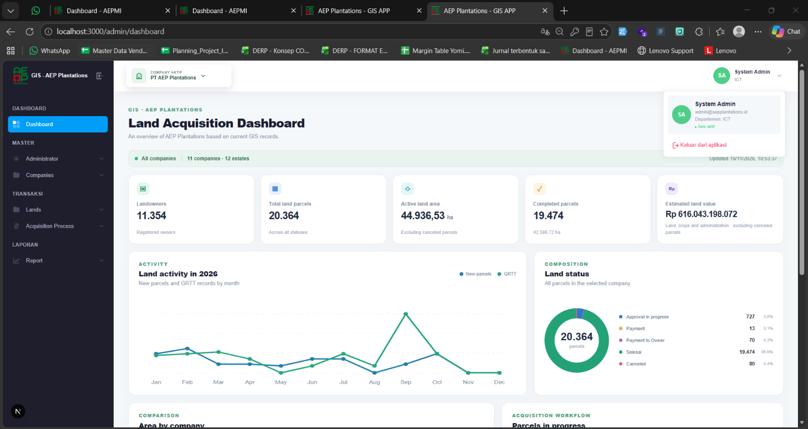
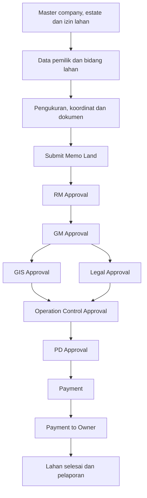

# AEP Plantations — GIS Application

Aplikasi GIS untuk mengelola data lahan dan memantau proses akuisisi di lingkungan AEP Plantations. Menggabungkan data pemilik, pengukuran, peta bidang lahan, dokumen, persetujuan, dan pembayaran dalam satu aplikasi berbasis web.

## Tujuan aplikasi

- Memusatkan informasi lahan per company dan estate agar mudah ditelusuri.
- Memantau kemajuan akuisisi dari pengajuan memo sampai pembayaran kepada pemilik.
- Menyediakan peta interaktif untuk melihat posisi bidang lahan dan lahan lain dalam company yang sama.
- Menyimpan riwayat proses, dokumen pendukung, dan memo untuk membantu pemeriksaan data.
- Memberikan ringkasan dashboard dan laporan untuk pemantauan operasional.

## Tampilan aplikasi



*Contoh tampilan dashboard. Angka pada screenshot merupakan kondisi saat gambar diambil.*

## Fitur utama

| Area | Fitur |
| --- | --- |
| Dashboard | Ringkasan bidang lahan, pemilik, luas, nilai lahan, aktivitas, dan status akuisisi. |
| Master data | Company, region, izin lahan, petugas, role, dan pengaturan proses bisnis. |
| Data lahan | Pemilik lahan, potential land, division, propose land, compensated land, dan canceled land. |
| Akuisisi | Submit memo, approval sesuai peran, payment, dan payment to owner. |
| Peta | Polygon terpilih merah, lahan selesai hijau, lahan lain kuning; popup pemilik, hektare, lokasi, dan status. |
| Dokumen | Tab informasi lahan, pengukuran/harga, dokumen, dan memo; detail dokumen melalui preview. |
| Akun | Login, pengaturan nama/password, dan forgot password melalui email SMTP. |
| Notifikasi | Worker email untuk cron dengan routing sesuai proses serta mode testing melalui konfigurasi. |
| Laporan | Laporan dan pemantauan progres lahan lintas company/estate sesuai akses pengguna. |

## Alur akuisisi



Alur di atas menggambarkan tahapan utama. Hak akses, petugas, dan ketentuan perpindahan tahap mengikuti konfigurasi proses bisnis serta validasi backend. Riwayat proses dapat dilihat dari detail lahan.

## Alur penggunaan peta

1. Pilih company dan buka detail lahan melalui menu Lands atau Acquisition.
2. Peta memusatkan tampilan pada lahan yang dibuka, ditandai merah.
3. Layer tambahan memuat lahan lain dalam company yang sama secara bertahap.
4. Klik polygon untuk melihat Land ID, pemilik, luas total/basah/kering dalam hektare, company, estate, desa, block plan, nomor izin, dan status.
5. Gunakan tab detail untuk melihat informasi lahan, pengukuran, dokumen, dan memo.

## Teknologi

- **Frontend:** Next.js 16, React 19, TypeScript, dan Leaflet.
- **Backend:** Go, HTTP API, dan pgx.
- **Database:** PostgreSQL dengan data spasial dari skema GIS yang sudah tersedia.
- **Email:** SMTP untuk reset password dan worker notifikasi akuisisi.

## Struktur project

```text
gis-app/
├── backend/
│   ├── cmd/notify-acquisition/   # Worker notifikasi untuk cron
│   ├── internal/controller/     # HTTP handler per modul
│   ├── internal/model/          # Akses database dan logika data
│   ├── internal/routes/         # Routing dan middleware
│   ├── migrations/              # Perubahan skema tambahan
│   ├── docs/                    # Dokumentasi API dan operasional
│   └── main.go                 # Server API
├── frontend/
│   ├── app/admin/               # Dashboard, master, lands, acquisition, report
│   ├── app/auth/                # Login dan pemulihan akun
│   ├── components/mapping/      # Layer company dan popup peta
│   └── public/                  # Aset statis aplikasi
└── docs/images/                 # Screenshot untuk dokumentasi
```

## Menjalankan lokal

Gunakan Node.js yang kompatibel dengan Next.js pada project ini, npm, dan Go sesuai versi pada [go.mod](backend/go.mod). Siapkan PostgreSQL dengan skema/data GIS aplikasi; migrasi tambahan tidak menggantikan keseluruhan database lama.

### Backend

```sh
cd backend
cp .env.example .env
# Isi koneksi database, session secret, origin frontend, dan SMTP pada .env.
go mod download
go run .
```

API secara default berjalan pada port `9000`. Sesuaikan `FRONTEND_ORIGIN` dengan alamat frontend yang diakses pengguna.

### Frontend

Jalankan di terminal terpisah:

```sh
cd frontend
cp .env.local.example .env.local
npm ci
npm run dev
```

Frontend development secara default di `http://localhost:3000`. Isi `NEXT_PUBLIC_API_URL` dengan alamat backend yang dapat diakses browser. Pada PowerShell, gunakan `Copy-Item` sebagai pengganti `cp` jika diperlukan.

### Build produksi

```sh
# Dari backend/
go build -o bin/gis-api .
go build -o bin/gis-notify ./cmd/notify-acquisition

# Dari frontend/
npm run build
npm run start
```

Siapkan environment, database, direktori dokumen, reverse proxy, dan akses jaringan sesuai server tujuan. Dokumen upload dan konfigurasi rahasia dikelola terpisah dari source code.

## Notifikasi dan mode testing

```dotenv
NOTIFICATION_TEST_MODE=true
NOTIFICATION_TEST_TO=your-test-mailbox@example.com
NOTIFICATION_BATCH_SIZE=1
```

Dalam mode testing, email hanya dikirim ke mailbox testing dan diberi penanda testing. Jalankan worker tanpa `--send` untuk preview baca-saja:

```sh
cd backend
go run ./cmd/notify-acquisition
```

Pengiriman sebenarnya menggunakan `--send`. Lihat [panduan cron dan notifikasi](backend/docs/acquisition-notifications.md) sebelum mengaktifkannya.

## Dokumentasi lanjutan

- [Workspace akuisisi](backend/docs/acquisition-workspace.md)
- [Mapping lahan per company](backend/docs/company-land-mapping.md)
- [Dokumen dan riwayat lahan](backend/docs/new-compensated-history-api.md)
- [Payment API](backend/docs/payment-api.md)
- [Dashboard API](backend/docs/dashboard-api.md)
- [Report API](backend/docs/report-api.md)
- [Pengaturan akun](backend/docs/account-api.md)
- [Forgot password](backend/docs/password-reset-api.md)
- [Mount dokumen di Docker/Linux](backend/docs/docker-document-mounts.md)

## Konfigurasi lokal

File environment asli, password, session secret, dokumen upload, cache, dan hasil build tidak disimpan dalam repository. File contoh environment hanya berisi template; isi nilai sebenarnya di komputer atau server masing-masing.
